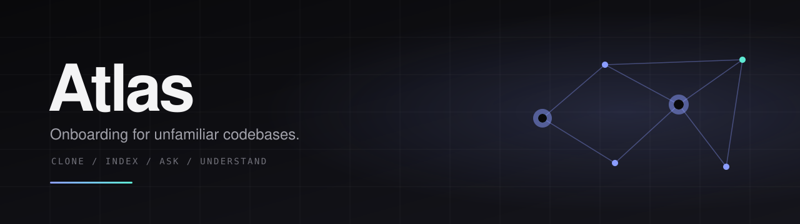
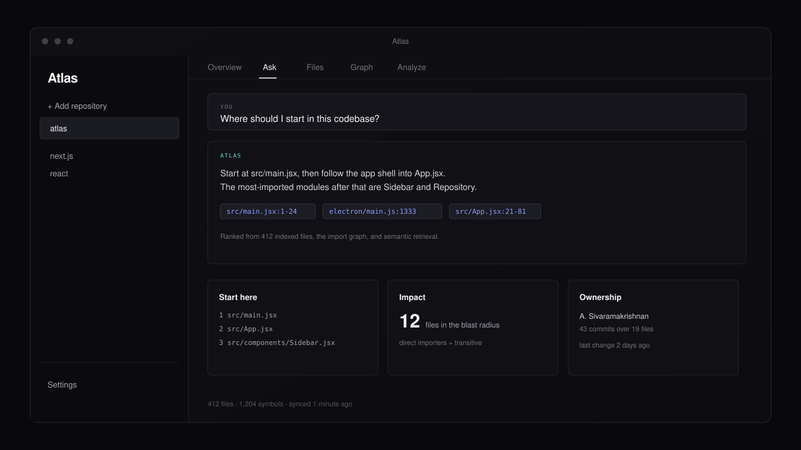

<p align="center">
  
</p>

<h1 align="center">Atlas</h1>

<p align="center">
  Point Atlas at a repository. It clones, indexes, and explains the codebase:
  where to start, how the files connect, what a change touches, and who to ask.
</p>

<p align="center">
  <a href="#quick-start">Quick start</a> ·
  <a href="#features">Features</a> ·
  <a href="#how-it-works">How it works</a> ·
  <a href="#configuration">Configuration</a> ·
  <a href="ROADMAP.md">Roadmap</a>
</p>

## Demo

<p align="center">
  
</p>

<!--
Loom walkthrough: record a short demo, then replace the image above with a
clickable card so GitHub renders the thumbnail and links out to the video:

<p align="center">
  <a href="https://www.loom.com/share/YOUR_VIDEO_ID">
    
  </a>
</p>
-->

## Features

- **Clone and index any Git repository.** Files, symbols, and imports are
  written to a local SQLite index; folder counts are derived from the clone.
  Progress is reported as the repository is cloned and indexed.
- **Ask grounded questions.** Answers cite the files and line ranges they came
  from. Retrieval prefers embeddings when they are available and falls back to
  lexical ranking when they are not, so a missing API key or an offline machine
  never blocks an answer.
- **Start here.** Atlas detects entry points and ranks the modules worth reading
  next by how many files import them, then presents one ordered reading path.
- **Explore the graph.** Open a file to see its symbols, what it imports, and
  what imports it.
- **Analyze impact.** See direct importers, the transitive blast radius of a
  change, symbol definitions and references, and files no entry point can reach.
- **Find the owner.** Churn hotspots, recent changes, and likely reviewers per
  file come from the clone's git history.
- **Keep the index fresh.** Atlas checks remotes in the background, fetches and
  re-indexes only repositories that moved, and lets you refresh or discard local
  changes on demand.
- **Configure it once.** Theme, sync schedule, AI provider, and storage usage
  live in a global Settings page. The NVIDIA NIM key is encrypted with Electron
  `safeStorage` when available (plain text is the fallback where it is not) and
  is never sent to the renderer.

## How it works

1. **Clone.** Atlas clones the repository into its data folder.
2. **Index.** The indexer walks source files, extracts symbols and imports,
   chunks file contents, and embeds chunks when an AI key is configured.
3. **Store.** SQLite is the single source of truth for repositories, files,
   symbols, imports, chunks, and vectors. There is no second vector store to
   keep in sync.
4. **Answer.** Graph and ownership questions are answered from the index
   directly. Everything else is grounded in retrieved excerpts and, when a key
   is available, summarized by NVIDIA NIM.

The app is Electron (main process) plus React (renderer), with a narrow IPC
surface exposed through `electron/preload.js`.

## Quick start

### Requirements

- Node.js 20.19+ or 22.12+ (Vite 8)
- npm
- Git

### Run from source

```bash
git clone https://github.com/thecerebralcosmocrat/atlas.git
cd atlas
npm install
npm run dev
```

`better-sqlite3` is a native module built for Electron's ABI. If it was
compiled for a different Electron version, rebuild it:

```bash
npm run rebuild
```

### First run

1. Paste a repository URL and wait for the clone and index to finish.
2. Use the repository tabs: **Overview**, **Ask**, **Files**, **Graph**, and
   **Analyze**.
3. Optionally open **Settings** and add an NVIDIA NIM API key. Without one,
   asking still works from the local keyword index.

## Configuration

Settings are global and apply to every repository. Values resolve in this
order:

1. A value saved on the Settings page
2. An environment variable
3. The built-in default

Environment variables are useful during development; the Settings page is the
supported path for packaged builds. In development, `.env` and `.env.local` are
read from the project root.

| Setting | Environment variable | Default |
|---|---|---|
| API key | `NVIDIA_NIM_API_KEY` | none |
| Chat model | `NVIDIA_NIM_MODEL` | `nvidia/nemotron-3-super-120b-a12b` |
| Chat endpoint | `NVIDIA_NIM_API_URL` | `https://integrate.api.nvidia.com/v1/chat/completions` |
| Embedding model | `NVIDIA_NIM_EMBED_MODEL` | `nvidia/nemotron-3-embed-1b` |
| Embedding endpoint | `NVIDIA_NIM_EMBED_API_URL` | `https://integrate.api.nvidia.com/v1/embeddings` |

See [`.env.example`](.env.example) for a starting point. The Settings page also
shows the app's data folder, database size, and cloned-repository usage, and can
open that folder in the file manager.

Atlas keeps everything under the Electron user-data directory in `atlas-data`:

```
atlas-data/
  atlas.db          # repositories, files, symbols, imports, chunks, vectors
  settings.json     # preferences and the encrypted API key
  repositories/     # clones
  repositories.json # legacy store, imported once on first launch
```

## Scripts

| Command | What it does |
|---|---|
| `npm run dev` | Runs Vite and Electron together |
| `npm test` | Runs the full test suite under Electron's Node |
| `npx vite build` | Builds the renderer into `dist/renderer` |
| `npm run build` | Builds the renderer and packages a Windows installer |
| `npm run db:stats` | Prints statistics from the SQLite index |
| `npm run index -- <path>` | Indexes a local folder into the database |
| `npm run rebuild` | Rebuilds native modules for Electron |

## Project layout

```
electron/
  main.js            # app lifecycle, IPC handlers, answers, sync poller
  preload.js         # contextBridge API for the renderer
  settings.js        # global settings, validation, key encryption
  db/                # schema and repository queries
  indexer/           # file traversal, symbol extraction, import resolution
  pipeline/          # chunking and embeddings
  query/             # search, graph, impact, ownership, start-here
  llm/               # NVIDIA NIM chat client
  storage/           # cloning and local repository state
  sync/              # remote checks and re-indexing
src/
  App.jsx            # app shell, routing, settings and repository state
  components/        # sidebar, file tree, chat, graph, impact, ownership
  pages/             # Onboarding, Repository, Settings
test/                # unit and integration tests
```

## Testing

`better-sqlite3` is compiled for the Electron ABI, so the suite runs through
Electron's bundled Node:

```bash
npm test
```

The tests cover the database schema, indexing, symbol extraction, import
resolution, retrieval, impact and ownership analysis, settings, sync, and the
main-process IPC wiring. Tests use temporary directories and local git origins;
no network access is required.

## Roadmap

Atlas is built in small vertical slices. Phase 1 (a working repository Q&A app),
Phase 2 (symbol graph and retrieval), and Phase 3 (start-here, impact, and
ownership) are complete. Phase 4 is in progress: global settings shipped, and
named workspaces that scope the sidebar are planned.

See [ROADMAP.md](ROADMAP.md) for the increments, decisions, and implementation
notes.

## License

ISC
